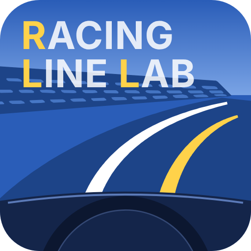

# Racing Line Lab

**シンプル走行ライン比較ツール**

RaceChronoなどのサーキットの走行ログ(.vbo)を読み込み、ラップごとの走行ラインと速度を、航空写真の地図の上で見比べる個人開発のアプリです。

自分の過去の走行と比べたり、他の方の走行とじっくりと比較して、次に走る時に**目指す走行ラインのイメージを脳内に描く**ための手助けとなるアプリを目指していますが、素人開発なので不具合があるかも知れません。悪しからずご了承ください。

## 主な機能

- **走行ログの読み込み**: RaceChrono の `.vbo` を、ドラッグ&ドロップで複数読み込めます。走行ログは 5 つの「比較セット」(「比較セット1」〜「比較セット5」)に分けて、別々の比べ方を保存しておけます。
- **はじめかた**: いまの状態に合わせて、次にやることを青いボタンで案内します。
- **サーキットの登録**: 計測ライン(コントロールライン)とセクターを、`.cln` / `.sci` ファイルから、または地図の上で線を引いて(住所検索で場所を探せます)登録できます(書き出しにも対応)。
- **ラップの検出**: 計測ラインの通過からラップを検出し、ラップタイムとセクタータイム(区間タイム / 通過時刻)を表にします。
- **A〜D への割り当て**: 比べたいラップを最大 4 つ選びます。
- **比較画面**
  - 国土地理院のシームレス空中写真(Z18、Z20 までデジタルズーム)の上に走行ラインと車の位置を表示
  - 走行ラインの速度・加減速ヒートマップ
  - 車から引き出し線を出して、速度と基準車とのタイム差を表示
  - 再生・コマ送り・再生速度の切り替え、先頭追従などのカメラ
  - 速度グラフ(横軸は距離 / 時間、拡大表示、セクター位置の表示)
  - セクターボタン(先頭車両に合わせる / 全車一致)
- **位置補正**: GPS のずれを、ログごとに東西・南北方向へメートル単位で補正できます。補正データの書き出し / 読み込みにも対応しています。
- **設定タブ**: テーマ、地図の初期位置・倍率、グラフの最低速度などの初期値を選べます。項目ごとに「最後の状態を記憶する」も選べます。
- **前回の走行データの自動読み込み**(デスクトップ版のみ): 前回のファイルと A〜D の割り当てを、起動時に元に戻します。

## 利用状況の送信(Web 版のみ)

Web 版では、アプリの改善のため、Google アナリティクスで利用状況(ページの表示、使っている環境など)を送ります。走行ログの中身や位置、ファイル名は送りません。「設定」タブの「利用状況の送信」でオフにできます。デスクトップ版(Electron)では送りません。

---

## 開発者

* 開発・公開: [bpfj3ndcbr](https://github.com/bpfj3ndcbr)(個人開発)
* リポジトリ: [https://github.com/bpfj3ndcbr/racing-line-lab](https://github.com/bpfj3ndcbr/racing-line-lab)
* © 2026 bpfj3ndcbr

不具合のご報告やご意見は、リポジトリの [Issues](https://github.com/bpfj3ndcbr/racing-line-lab/issues) へどうぞ(個人開発のため、対応できないこともあります)。

## 📜 ライセンス・利用規約と権利表記 (License & Credits)

### 1. 本アプリケーションのライセンス

本プロジェクトのソースコードは [MIT License](https://github.com/bpfj3ndcbr/racing-line-lab/blob/main/LICENSE) のもとで公開されています。商用・非商用を問わず自由にご利用・改変・再配布いただけます。

### 2. 地図タイルに関する権利表記

本アプリケーションでは、背景地図に国土地理院の提供する地理院タイルを使用しています。

* 地理院タイル(シームレス空中写真): [国土地理院](https://maps.gsi.go.jp/development/ichiran.html) 出典表記: 「地理院タイル(シームレス空中写真)」(利用規約に基づき、アプリケーション画面内の地図に明記されています)

### 3. 使用サードパーティライブラリ

* Leaflet: © Volodymyr Agafonkin, BSD-2-Clause License
* Electron: © Electron contributors, MIT License
* Vite: © Evan You & Vite Contributors, MIT License(ビルドに使用)

各ライブラリのライセンス詳細および著作権表記については、[THIRD-PARTY-NOTICES.txt](https://github.com/bpfj3ndcbr/racing-line-lab/blob/main/THIRD-PARTY-NOTICES.txt) をご参照ください。
