<p align="center">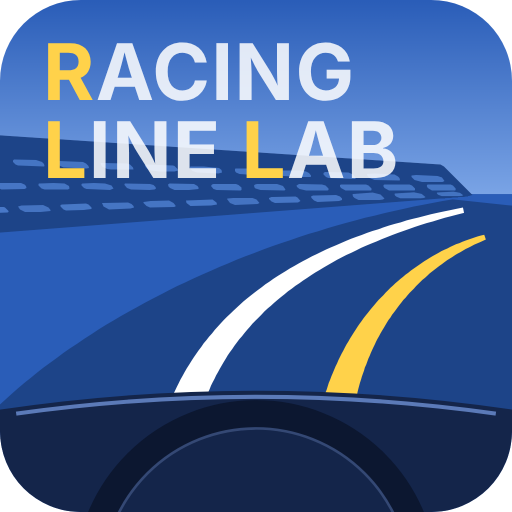</p>

# Racing Line Lab

**シンプル走行ライン比較ツール**

RaceChronoなどのサーキットの走行ログ(.vbo)を読み込み、ラップごとの走行ラインと速度を、航空写真の地図の上で見比べる個人開発のアプリです。

  
自分の過去の走行と比べたり、他の方の走行とじっくりと比較して、次に走る時に**目指す走行ラインのイメージを脳内に描く**ための手助けとなるアプリを目指していますが、素人開発なので不具合があるかも知れません。悪しからずご了承ください。

■ デスクトップ版について

デスクトップ版(Electron)は、自分のMac上でアプリの形式に最終組み立てしてから使います。

デスクトップ版の対応OSは今のところ macOS のみです。

デスクトップ版の .appや.dmgはとりあえず配布しません。自身のMacにNode.jsをインストールしてアプリを最終組み立てをしてから使います。  
(Homebrew が入っていれば意外と簡単です)

  
他人が配布する .app や .dmg をインストールするのは少し難しいのでこの形式にしています。

■ Web版について

自身でアプリの組み立てをしなくても使用可能なWeb版も公開します。  
Web版はスマホなどにアプリとしてインストールでき、一度開いたあとは、ネットが無い場所でも使えます(地図は、保存した範囲だけ表示されます。詳しくは「[ネットがない場所で使う](#ネットがない場所で使う)」)。  
Web版はスマホ・タブレットのブラウザでも使えます(画面の幅に合わせて並びが変わります。スマホは縦向きでの利用を想定しています)。  
ただし、Web版は前回読み込んだ走行データは保存がされませんので少し不便です(同じタブの中で画面が読み直されたときは、元に戻ります)。

※ Web版ではアプリの改善のため、Google アナリティクスで利用状況を送ります(詳しくは「[利用状況の送信](#利用状況の送信web-版のみ)」)。

[公開URL]
<https://bpfj3ndcbr.github.io/racing-line-lab/>

## 主な機能

- **走行ログの読み込み**: RaceChrono の `.vbo` を、ドラッグ&ドロップで複数読み込めます。走行ログは 5 つの「比較セット」(「比較セット1」〜「比較セット5」)に分けて、別々の比べ方を保存しておけます。
- **はじめかた**: いまの状態に合わせて、次にやることを青いボタンで案内します。
- **サーキットの登録**: 計測ライン(コントロールライン)とセクターを、`.cln` / `.sci` ファイルから、または地図の上で線を引いて(住所検索で場所を探せます)登録できます(書き出しにも対応)。
- **ラップの検出**: 計測ラインの通過からラップを検出し、ラップタイムとセクタータイム(区間タイム / 通過時刻)を表にします。
- **A〜D への割り当て**: 比べたいラップを最大 4 つ選びます。
- **比較画面**
  - 国土地理院のシームレス空中写真(Z18、Z20 までデジタルズーム)の上に走行ラインと車の位置を表示
  - 走行ラインの速度・加減速ヒートマップ
  - 車から引き出し線を出して、速度と基準車とのタイム差を表示
  - 再生・コマ送り・再生速度の切り替え、先頭追従などのカメラ
  - 速度グラフ(横軸は距離 / 時間、拡大表示、セクター位置の表示)
  - セクターボタン(先頭車両に合わせる / 全車一致)
- **位置補正**: GPS のずれを、ログごとに東西・南北方向へメートル単位で補正できます。補正データの書き出し / 読み込みにも対応しています。
- **設定タブ**: テーマ、地図の初期位置・倍率、グラフの速度の範囲などの初期値を選べます。項目ごとに「最後の状態を記憶する」も選べます。
- **前回の走行データの自動読み込み**(デスクトップ版のみ): 前回のファイルと A〜D の割り当てを、起動時に元に戻します。

## 利用状況の送信(Web 版のみ)

Web 版では、アプリの改善のため、Google アナリティクスで利用状況(ページの表示、使っている環境など)を送ります。走行ログの中身や位置、ファイル名は送りません。「設定」タブの「利用状況の送信」でオフにできます。デスクトップ版(Electron)では送りません。

## インストール方法

デスクトップ版は、お使いの Mac 上でアプリの形に組み立ててから使います。最初に 1 回だけ、次の手順が必要です(所要時間は 10〜20 分ほどです)。

### 1. Node.js をインストールする

アプリを組み立てるために Node.js(バージョン 20 以上)を使います。すでに入っている場合は、手順 2 へ進んでください。確認は、ターミナルで `node -v` と入力して、`v20` 以上の番号が出れば大丈夫です。

> **ターミナルの開き方**: Finder で「アプリケーション」→「ユーティリティ」→「ターミナル」を開きます。(Spotlight 検索 `⌘ + Space` で「ターミナル」と入力しても開けます)

**方法 A: Homebrew が入っている場合(簡単)**

ターミナルに次を入力して Return キーを押します。

```
brew install node
```

**方法 B: インストーラを使う場合**

1. [Node.js の公式サイト](https://nodejs.org/ja)を開きます。
2. 「LTS」と書かれた版をダウンロードします(macOS 用の `.pkg`)。
3. ダウンロードした `.pkg` をダブルクリックし、画面の案内に従って進めます。

インストール後、ターミナルを開き直して `node -v` と入力し、番号が出れば完了です。

### 2. アプリのファイル(zip)をダウンロードする

1. [GitHub のこのページ](https://github.com/bpfj3ndcbr/racing-line-lab)を開きます。
2. 緑色の **「Code」** ボタンを押し、**「Download ZIP」** を選びます。
3. 「ダウンロード」フォルダに `racing-line-lab-main.zip` ができます。

### 3. zip を展開する

ダウンロードした zip をダブルクリックすると、同じ場所に `racing-line-lab-main` フォルダが作られます。

### 4. アプリを組み立てる(npm install と npm run dist)

ターミナルで、展開したフォルダに移動します。`cd` と半角スペースを入力してから、Finder のフォルダをターミナルへドラッグ&ドロップすると、場所が入力されます。そのあと Return キーを押します。

```
cd ~/Downloads/racing-line-lab-main
```

続けて、次の 2 つを 1 つずつ実行します。それぞれ、終わるまで数分かかります。

```
npm install
```

```
npm run dist
```

エラーが出ずに終われば、アプリの組み立ては完了です。

### 5. .dmg からインストールする

1. Finder で、展開したフォルダの中の `release` フォルダを開きます。
2. できている `.dmg` ファイルをダブルクリックします。
3. 開いた画面で、アプリのアイコンを「Applications(アプリケーション)」フォルダへドラッグします。

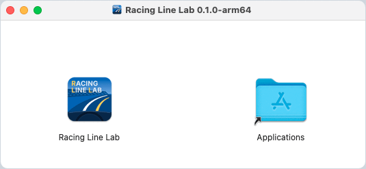

> ウインドウの題や `.dmg` のファイル名に入る番号(画像では `0.1.0`)は、アプリの版によって違います。

**起動するとき**: 自分でビルドしたアプリは、通常はそのままダブルクリックで起動できます。もし「開発元を確認できません」などの警告が出たら、アプリを **右クリック(control + クリック)→「開く」** で起動してください。(このアプリは Apple の署名を受けていないため、ビルドしたアプリを AirDrop やメールなどで別の Mac に渡した場合は、その Mac で警告が出ます。)

> **アプリを新しい版に入れ替えるとき**は、新しい zip をダウンロードして、手順 3〜5 を繰り返します。(手順 1 の Node.js は 1 回だけで大丈夫です)

### うまくいかないとき

| 症状 | 対処 |
|---|---|
| `node: command not found` と出る | Node.js が入っていません。手順 1 をやり直し、ターミナルを開き直してください。 |
| `npm install` で長時間止まる・エラーになる | ネットワークにつながっているか確認して、もう一度実行してください。 |
| `release` フォルダが無い | `npm run dist` が最後まで終わっていません。画面の最後のメッセージを確認してください。 |
| 起動しようとすると「開発元を確認できません」と出る | アプリを右クリック →「開く」で起動してください。 |

## 使い方

画面の上部に、**「使い方」「データ管理」「比較」「設定」** の 4 つのタブがあります。「使い方」タブでは、この説明(「使い方」と「そのほかの操作」)をアプリの中で読めます。

> この説明の画像は、「使い方」タブを追加する前の画面です。そのため、上部のタブは「データ管理」「比較」「設定」の 3 つで写っています。サーキットの登録の画面も、今とは見た目が少し異なります。

はじめて使うときは、「データ管理」タブの上のほうにある **「はじめかた」** に沿って進めるのがかんたんです。「はじめかた」は、いま表示している比較セットの状態に合わせて、次にやることを **「いまここ」** の印と **青いボタン** で案内します。上から順に青いボタンを押していけば、走行ラインを見比べるところまで進めます。

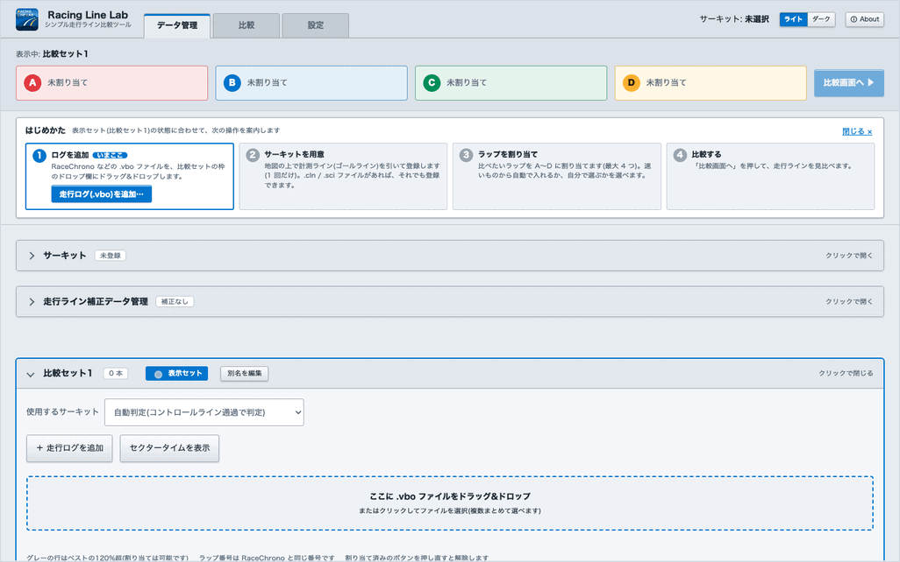

流れは次の 4 つです。

1. **ログを追加**: 走行ログ(.vbo)を読み込む
2. **サーキットを用意**: 計測ラインを決めて、サーキットを登録する(サーキットごとに、はじめの 1 回だけ。走行ログに計測ラインの情報があれば、それを使えます)
3. **ラップを割り当て**: 比べたいラップを A〜D に割り当てる
4. **比較する**: 「比較」タブで見比べる

ここでは、走行ログを 2 つ(1 つ目は 1 ラップ、2 つ目は 2 ラップ)読み込んで、3 つのラップを見比べるまでを、例として説明します。

> 「はじめかた」は「閉じる ×」で畳めて、「はじめかた ▸」でまた開けます。一度比較まで進むと、次の起動からは畳んだ状態で始まります。

### 手順 1. 走行ログを追加する

「はじめかた」の手順 1 にある青いボタン **「走行ログ(.vbo)を追加…」** を押して、RaceChrono から書き出した `.vbo` ファイルを選びます。複数のファイルをまとめて選べます。

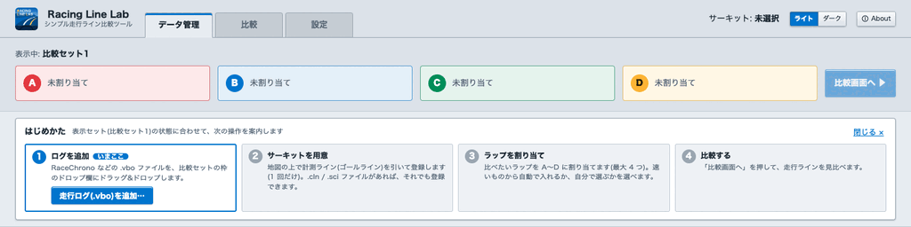

画面の下のほうにある **「比較セット1」** の枠の **ドロップ欄**(点線の枠)に、ファイルをドラッグ&ドロップしても追加できます。

読み込むと、ファイルごとに枠(「Run 1」「Run 2」…)ができます。まだサーキットが登録されていないので、「サーキット未判定」と出て、ラップの一覧は空のままです。同時に、**「読み込んだ走行ログの確認」** の画面が開きます(手順 2)。「はじめかた」も手順 2 に進みます。

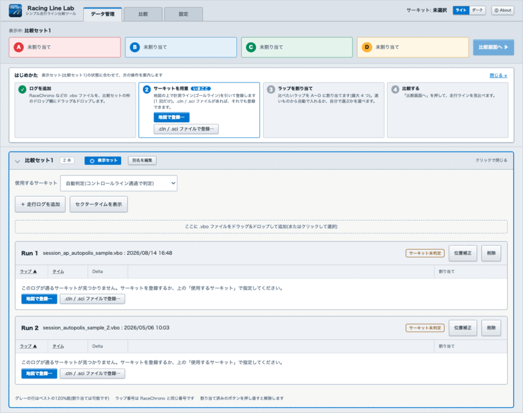

### 手順 2. サーキットを用意する

ラップを数えるには、サーキットの **計測ライン**(コントロールライン。ラップの計測を始めるゴールライン)が必要です。登録したサーキットは、次回からも使えます。

サーキットを判定できない走行ログを読み込むと、**「読み込んだ走行ログの確認」** の画面が開きます。この比較セットで使う計測ライン(サーキット)を、一覧から 1 つ選びます。一番上に、いま選んでいるものが出ます。

- **ファイルの行**: そのファイルから作った計測ラインを選べます。走行ログの中にある計測ラインの情報(RaceChrono で書き出したログ。「ファイル内のサーキット名「○○」で登録」)か、1 周分だけのログの始点と終点から計算した計測ライン(「計算した計測ラインで登録」)です。
- **登録済みのサーキット**: 読み込んだログが通る、登録済みのサーキットがあるときに出ます。
- **地図で登録**: 地図の上で、自分で線を引きます(下の「地図で計測ラインを引いて登録する」)。
- **あとで**: 未判定のままにします。あとから、ログの枠や「はじめかた」の手順 2 のボタンで登録できます。

各ファイルの行には、選んだ計測ラインでそのファイルがどうなるか(「選択中」「通ります(ラップあり)」「選択中の計測ラインを通りません(ラップ無し)」)が出ます。通るログは、まとめて判定されます。

読み込むファイルを間違えたときは、左下の **「読み込みを取り消す」** を押します。いま読み込んだ走行ログが比較セットから外れて、読み込む前に戻ります(前から入っていた走行ログは、そのまま残ります)。Esc キーで閉じたときは、「あとで」と同じく、読み込んだまま閉じます。

#### 走行ログの計測ラインで登録する

1. ファイルの行で、計測ラインを選びます。右上に、その計測ラインと付近の走行ラインが、地図で表示されます。コースを横切る向きになっているかを確かめます。
2. **「登録するサーキット名」** を確かめます(走行ログにあるコース名が入っています。必要なら直します)。
3. 線の向きや位置を直すときは、地図の左上の **「計測ラインを修正」** を押します。地図の右上で **「セクター」** を選ぶと、1 周分の走行ラインとセクターが表示され、ボタンが **「セクターを修正」** になります。セクターも直したり、足したり、消したりできます(下の「登録の前に計測ラインとセクターを直す」)。
4. **「この計測ラインで登録」** を押します。そのまま登録されて、ラップの一覧が出ます。

> 走行ログの計測ラインの情報は、実際の線と少しずれていることがあります。航空写真の路面の線などと見比べて、ずれていれば登録の前に直してください。登録したあとに直すときは、「サーキット」の「登録済みサーキット」タブから、地図で編集します。

#### 登録の前に計測ラインとセクターを直す

「計測ラインを修正」か「セクターを修正」を押すと、同じ画面の中で地図が大きくなり、計測ラインとセクターを直せます。右の欄の **「ライン」** の一覧(計測ライン、S1、S2…)で、直す線を選びます。選ぶと、地図がその線の位置へ移ります。「計測ラインを修正」から開いたときは計測ラインが、「セクターを修正」から開いたときは S1 が選ばれています。選んでいる線の直す前の位置は、灰色の破線で表示されます。

- **角度**: スライダー、数値入力(北から時計回りの角度。0.1° 刻み)、**「−」「+」** で回します。両端のつまみをドラッグしても回せます(長さは変わりません)。直す前と後の角度と、その差が出ます。
- **位置**: 中央のつまみをドラッグするか、矢印キーで動かします(Shift を押しながらだと 10 倍)。直す前から動かした距離が出ます。
- **「選んだ線を補正前に戻す」**: 選んでいる線を、走行ログから作ったときの線に戻します。
- **セクターを足す**: **「セクターを追加」** を押してから、地図の上でコースを横切るようにドラッグします(Esc キーでやめられます)。
- **セクターを消す**: 一覧の **「×」** を押します。計測ラインは消せません。

セクターは、走行ログが通った順に自動で並べ替わり、番号(S1、S2…)も振り直されます。一覧には、直した線に「修正済み」、足した線に「追加」、走行ログが通らない線に「通りません」と出ます(通らない線は一覧の最後に並びます)。

直したら **「この位置にする」** を押して、元の画面に戻ります(**「キャンセル」** か Esc キーなら、直さずに戻ります。線を直したあとなら「修正した内容が反映されていません」と確認が出て、**「破棄して戻る」** で戻り、**「修正を続ける」** で修正の画面に残ります)。一番上の「計測ライン」「セクター」に「修正あり」と出るので、そのまま「この計測ラインで登録」を押します。

#### 地図で計測ラインを引いて登録する

計測ラインの情報が無いログでは、地図の上で、自分で線を引いて登録します。

1. 「読み込んだ走行ログの確認」で「地図で計測ラインを引いて登録」を選んで「次へ(地図で登録)」を押すか、「はじめかた」の手順 2 にある **「地図で登録…」** を押します。走行ログの場所を中心に、航空写真の地図が大きく開きます。
2. 上の帯の **「サーキット名」** に、サーキットの名前(例: オートポリス)を入力します。

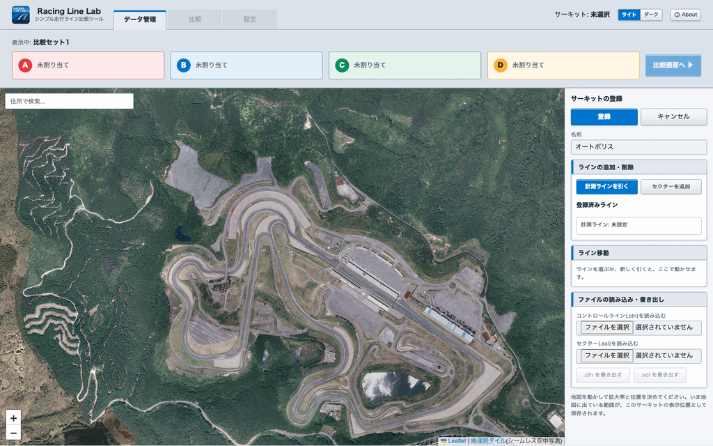

> 地図が別の場所で開いたときは、地図の左上の検索窓に住所を入力して Return キーを押すと、その場所へ移動します(インターネットへの接続が必要です)。

#### 計測ラインを引く

3. 地図を拡大して、計測ラインを引く場所(ふつうは、メインストレートのコントロールライン)を大きく表示します。拡大して引くほど、正確に引けます。
4. **「計測ラインを引く」** を押します。
5. 地図の上で、コースを **横切るように**、片側のコースの外から反対側のコースの外まで **ドラッグ** します。
6. 線の端のつまみや、「ライン移動」の矢印のボタン(または矢印キー)で位置を直して、**「確定」** を押します。

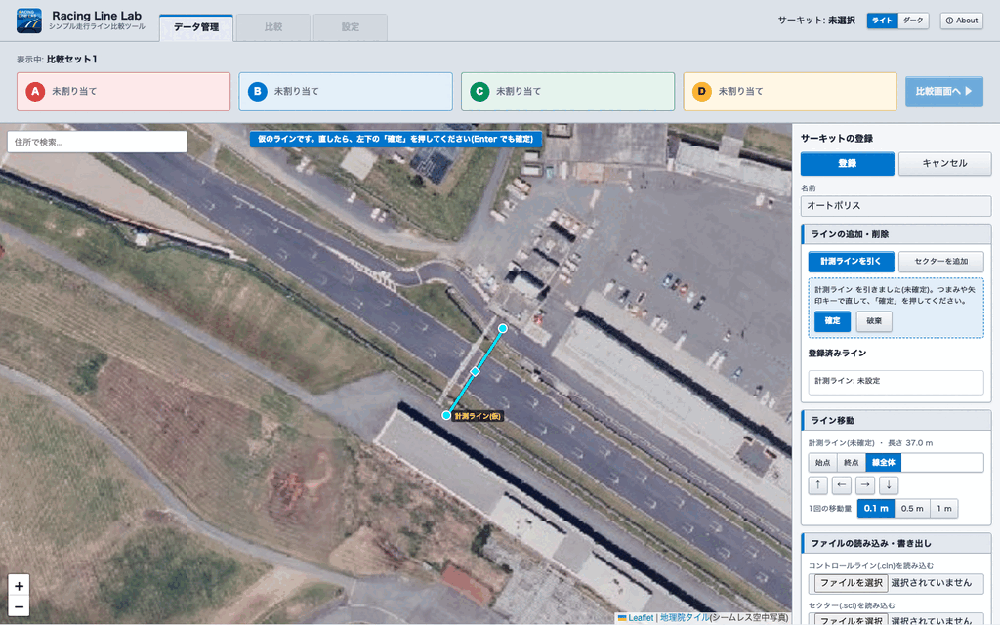

**例: オートポリス(大分県)の計測ライン**

上の画像は、オートポリスの計測ラインを引いた例です。メインストレートの、ピットの建物の前を、コースを横切る向きに引いています。線の両端の位置は、次のとおりです(長さは約 37 m)。

| | 緯度 | 経度 |
|---|---|---|
| 始点 | 33.038828 | 130.973361 |
| 終点 | 33.038551 | 130.973143 |

計測ラインを引くときの注意:

- **長さは、コースの幅より少し長いくらい** にします。長すぎる(60 m を超える)と、「長めです」と表示されます。近くを通る別のコースの通過まで拾ってしまうことがあるためです。
- **コースに対して、なるべく直角に** 引きます。
- 引いた計測ラインは、あとから引き直せません。やり直すときは、「登録済みライン」の一覧で計測ラインの **「×」** を押して消してから、もう一度引きます。

#### セクターを読み込む(.sci ファイル)

セクター(区間の境目の線)があると、セクターごとのタイムを比べられます。セクターは無くても構いません。

7. 右の欄の下にある **「ファイルの読み込み・書き出し」** の **「セクター(.sci)を読み込む」** で、`.sci` ファイルを選びます。読み込んだセクターが、地図と「登録済みライン」の一覧(S1、S2…)に出ます。

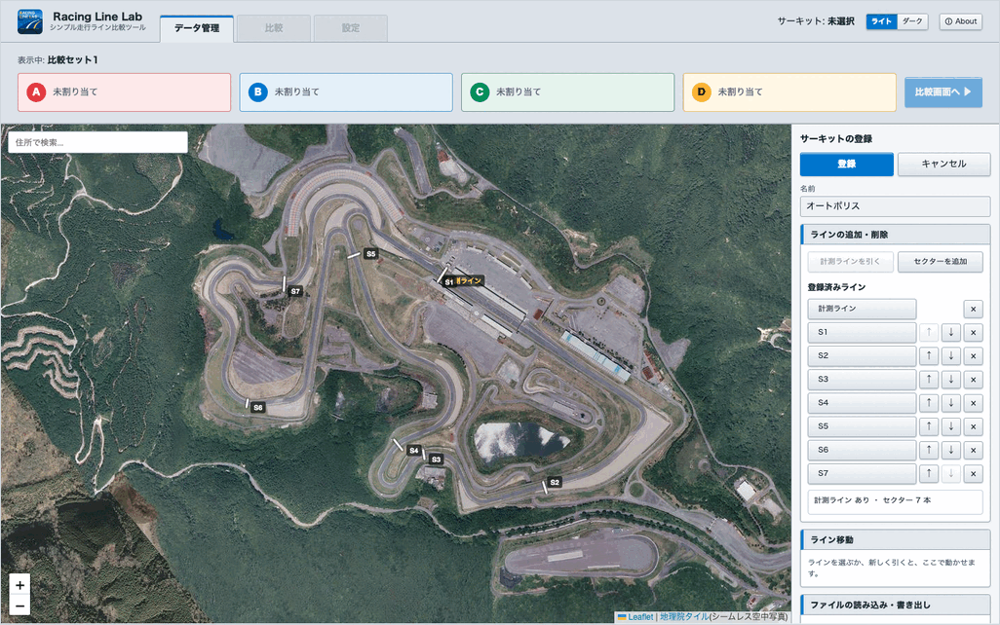

> セクターも、「セクターを追加」を押して、計測ラインと同じように地図の上で引けます。一覧の「↑」「↓」で順番を入れ替えられます。「登録済みライン」の右の **「セクター整列」** を押すと、読み込み済みの走行ログがセクターを通った順に、まとめて並べ替えます(計測ラインを通って 1 周を走り切った走行ログが必要です。走行ログが通らないセクターは最後に並びます)。

#### 登録する

8. 地図を動かして、サーキット全体が入る拡大率と位置にします。いま地図に出ている範囲が、このサーキットの表示位置として保存されます。
9. 上の帯の **「登録完了」** を押します。

登録すると、走行ログが計測ラインを通った場所から、使うサーキットが自動で選ばれ(「自動判定」)、ラップの一覧が出ます。「はじめかた」は手順 3 に進みます。

> 登録の画面を開いているあいだは、上部のタブは押せません(A〜D のカードも隠れます)。「登録完了」か「キャンセル」をすると、また移動できます。計測ライン・セクター・サーキット名を変えたまま「キャンセル」を押すと、「編集中の内容が保存されていません」と確認が出ます。**「破棄して閉じる」** で変更を捨てて閉じ、**「編集を続ける」**(または Esc キー)で編集に戻ります。

### 手順 3. ラップを割り当てる

「はじめかた」の手順 3 にある青いボタン **「速いものから A に自動で割り当て」** を押します。各走行ログのベストラップが、速い順に、空いている枠へ(A から)割り当てられます。この例では、2 つの走行ログのベストラップが、A と B に入ります。

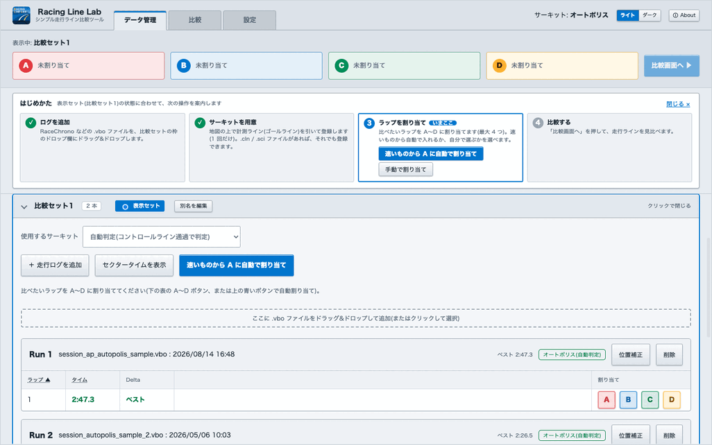

割り当てたラップは、画面の一番上の **A〜D のカード** に表示されます。「はじめかた」は手順 4 に進みます。

#### 割り当てを追加・変更する(手動で割り当て)

自動で割り当てたあとに、ほかのラップも比べたいときや、割り当てを替えたいときは、ラップの一覧の右端にある **A / B / C / D** のボタンで、自分で割り当てます。(「はじめかた」の「手動で割り当て」を押すと、ラップの一覧が見える位置までスクロールします。)

この例では、2 つ目の走行ログ(Run 2)の遅いほうのラップ(LAP 1)を、C に追加します。

1. Run 2 のラップの一覧で、LAP 1 の行の **「C」** を押します。
2. 上の C のカードに「Run 2 / LAP 1」が表示されます。これで、A〜C の 3 つのラップを比べられます。

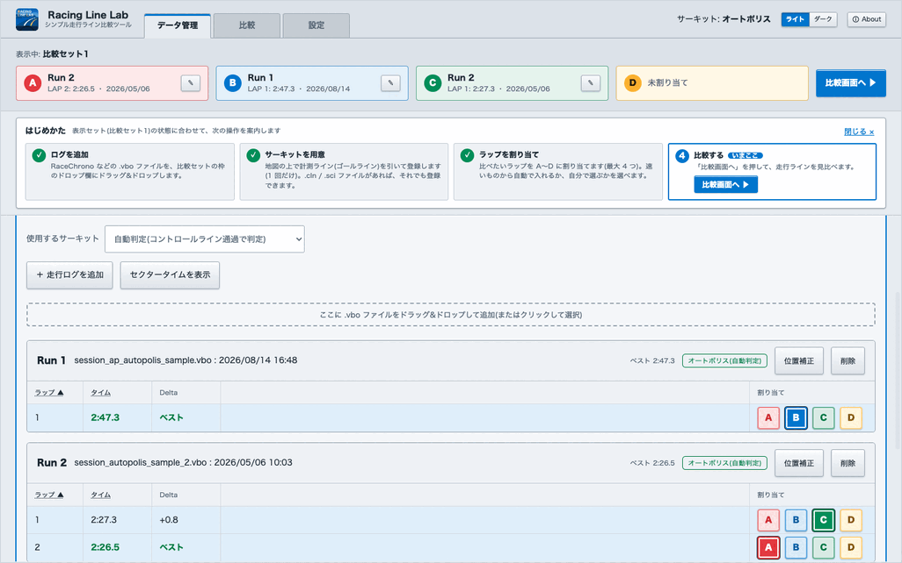

- 割り当て済みのボタンを **もう一度押すと、外れます**。
- 割り当て済みのラップで **別の枠のボタンを押すと、その枠へ移ります**(例: C に入っているラップで「D」を押すと、D へ移って C は空きます)。
- **すでにほかのラップが入っている枠** のボタンを押すと、入れ替わります(前に入っていたラップは外れます)。
- 最大 4 つ(A〜D)まで比較できます。

### 手順 4. 比較画面で見比べる

「はじめかた」の手順 4 にある青いボタン(またはカードの右の)**「比較画面へ ▶」** を押すと、「比較」タブが開きます。割り当てたラップの走行ラインと車の位置を、航空写真の上で見比べます。

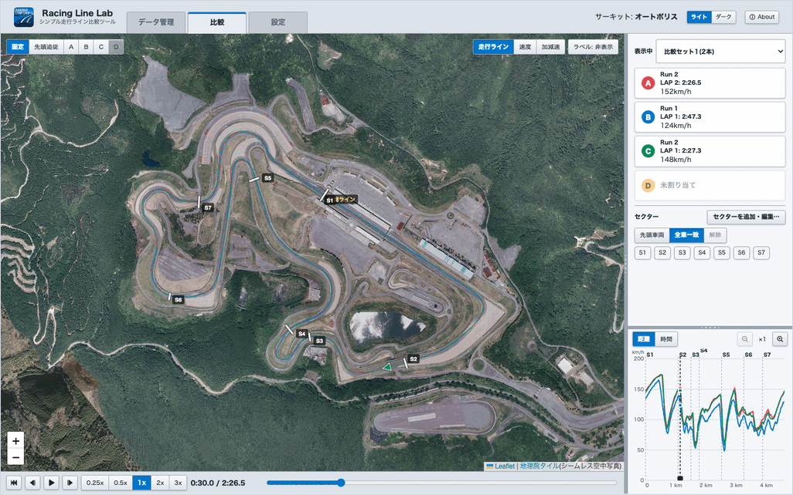

**地図の見かた**

- 地図の左上の **「固定 / 先頭追従 / A〜D」** で、地図の動きを選びます。先頭追従や A〜D を選ぶと、その車を追いかけて地図が動きます。
- 右上の **「走行ライン / 速度 / 加減速」** で、ラインの色分けを切り替えます。「速度」は速度の高低、「加減速」は加速と減速で色が変わります。
- 地図の右上の **「ラベル」** ボタンで、各車から出る線(引き出し線)の表示を、押すたびに「非表示 → 速度・差 → カード名」と切り替えます。「速度・差」は、速度と基準車とのタイム差(秒)です。「カード名」は、そのカードの名前だけです(名前が無いカードは A〜D)。

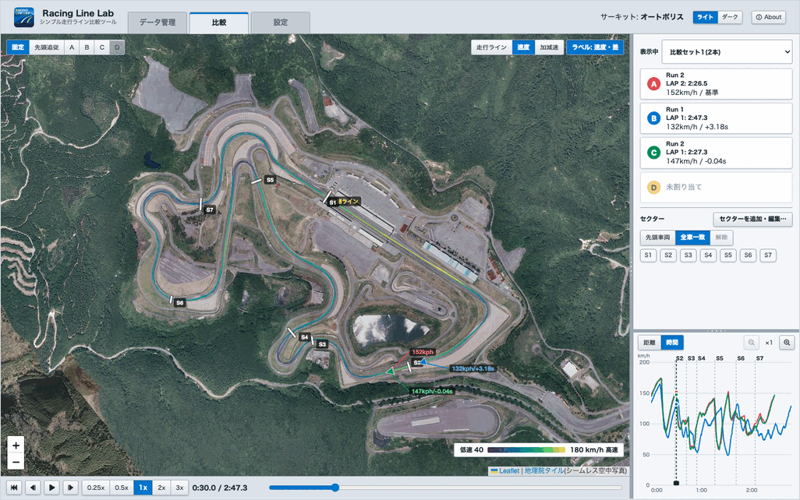

**再生する**

- 地図の下の再生ボタンで、再生・一時停止、先頭に戻る、コマ送り(0.1 秒)ができます。
- 再生速度は、ボタン(0.25x〜3x)で切り替えられます。
- スライダーをドラッグすると、好きな位置へ移れます。
- キーボードでは、Space(再生/一時停止)、← →(コマ送り、Shift で 1 秒)が使えます。
- スマホ・タブレットでは、地図を指で軽くたたくと再生/一時停止します(2 本の指で広げる・狭めると拡大・縮小)。

**右のパネル**

- **カード**: A〜D のラップ(Run 番号・LAP・タイム)と、いまの速度・タイム差が出ます。カードに名前を付けているときは、名前が上に出て、Run 番号が小さく添えられます。押すと、その車の地図上の表示/非表示を切り替えられます。
- **表示中**: カードの上のプルダウンで、比較する比較セットを切り替えられます。
- **セクターを追加・編集…**: 「セクター」の見出しの横のボタンで、いま比べているサーキットの編集画面(地図)が開きます(「セクターを追加」が青く出ます)。セクターを足したいときに使います。セクターだけの変更なら、A〜D の割り当ては残ります。終わると比較画面に戻ります。
- **セクター**: セクターのボタンを押すと、各車をそのセクターの位置に合わせます(「先頭車両」「全車一致」は時間ベースのときの動作です。距離ベースでは、基準の車がそのセクターを通る位置へ移り、ほかの車もそのセクターの位置に並びます)。「先頭車両」は先頭の車に、「全車一致」は全車が同じ位置になります。「解除」で通常の表示に戻ります。
- **速度グラフ**: 横軸は「距離」か「時間」を選べます。**「距離」のときは、地図の再生も距離ベースになります**: 基準の車(いちばん若い枠の車)を再生し、ほかの車はコース上の同じ位置に出ます。その場所での走行ラインと速度を見比べられます。距離は、各車の走行ラインを 1 台の走行ラインに重ねて決めるので、走行ラインの違いや速度の記録の誤差で、車ごとにずれていくことはありません(重ねる先は、記録の間隔がいちばん細かい車)。先頭追従は、基準の車を追いかけます。タイム差は出さず、カードと地図のラベルには速度だけを出します。「時間」のときは、全車が同じ経過時間の位置に出て、タイム差も出ます。「+」「−」で、再生位置を中心に拡大・縮小できます。拡大中は「−」の左に「全体」が出て、全体表示に戻せます。

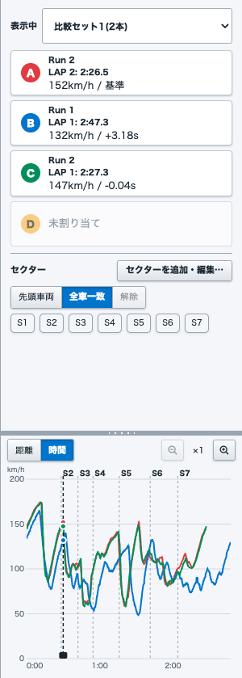

## そのほかの操作

### ラップの一覧

走行ログの枠には、ファイルごとにラップの一覧(ラップタイム・ベストとの差(Delta))が出ます。

- **セクタータイムを表示**: ボタンでセクタータイムの表を出します。「区間タイム」と「通過時刻」を切り替えられます。紫の数字は、そのデータ内での各セクターの最速です。
- **並べ替え**: 「ラップ」「タイム」の見出しを押すと、並び順を切り替えられます。
- **ラップ番号**: 計測ラインを最初に通過したところから 1、2、… と数えます。計測ラインの位置によっては、RaceChrono などのラップ番号と異なる場合があります。
- **最初と最後のラップ**: 最後に計測ラインを通過したあとの走行は、「終端未通過のため参考値」のラップとして出ます(割り当てもできます)。最初に通過する前の走行はラップにならず、「始点が無いので非表示」と出ます。
- **終端の調整**: ベストより大幅に長いラップ(途中で止まったラップなど)と、終端未通過のラップには、「終端の調整」が出ます(セクタータイムを隠しているとき)。チェックを入れるとスライドバーが出て、ラップの終わりを 10 秒単位で決められます(← → キーでも動かせます)。10 分を超える長いラップでは、スライドバーの左半分で最初の 5 分を、右半分で残りの時間を選びます。縮めたラップは参考値になります。計測ラインを変えると、調整は元に戻ります。
- **1 LAP のみのファイル**: 1 周分だけのファイルは、ファイルの計測線とアプリの計測線が異なっていても、1 周分のラップになります。一覧には「計測線付近の修正あり」と出ます。
- **手動で割り当て**: 右端の **A / B / C / D** のボタンを押すと、そのラップが A〜D に割り当てられます。もう一度押すと外れます(詳しくは「手順 3」の「割り当てを追加・変更する」)。
- **削除**: ファイルの「削除」で、その比較セットから取り除きます(元のファイルは消えません)。

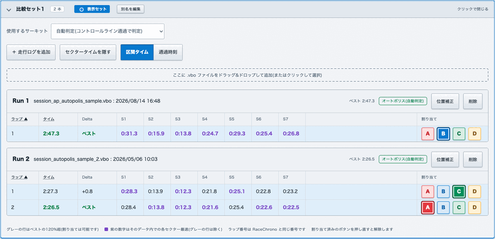

### カード名を付ける

画面の一番上の A〜D のカードの右にある **「✎」** で、カードに名前(6 文字まで)を付けられます。名前は、比較画面のカードと、地図の引き出し線(「カード名」)に出ます。名前は「比較セットごとの A〜D」に付くので、割り当てるラップを替えても残ります。

### 比較セット(1〜5)を使い分ける

「データ管理」タブの **「比較セット1」〜「比較セット5」** は、それぞれが独立した入れ物です。走行ログ(.vbo ファイル)を入れて、A〜D の割り当てやサーキットの指定と一緒に保存します。別々の比べ方を 5 つまで保存しておけます。(たとえば「自分の今日と先週」「別のサーキットのベストラップ」のように使い分けます。)

- ドロップが効くのは、その比較セットのドロップ欄の上に落としたときだけです。落とした場所の比較セットに入ります。
- 同じファイルを、別の比較セットにも入れられます。比較セットごとに、割り当てやサーキットを別々にできます。
- **比較セットのサーキットは 1 つです。** 最初に判定できた(または選んだ)サーキットが、その比較セットのサーキットになります。その計測ラインを通らない走行ログ(別のサーキットのログ)は、ラップの無いログとして入ります。別のサーキットのログは、別の比較セットに入れてください。
- **比較セットの並べ方を切り替える**: 「比較セット」の枠の右上の **「タブ / 一覧」** で選びます。**タブ**(はじめはこちら)では、比較セット1〜5のタブを押して 1 つずつ表示します。表示セットのタブには「表示中」の印が付きます。別名を付けた比較セットは、タブに別名が出ます。**一覧**では、比較セットを縦に並べ、見出しを押して開閉します。見出しには、サーキット名と A〜D の割り当ての状況が出ます。選んだ並べ方は、次に開いたときも使われます。
- **表示する比較セットを切り替える**: 比較セットの見出しにある **「表示中にする」** を押します。比較画面に出す比較セット(表示セット)には **「表示中」** の印が付き、上のカードの題にも同じ印と比較セットの名前が出ます。比較画面に出せるのは A〜D にラップを割り当てた比較セットだけなので、「表示中にする」は割り当てがある比較セットでだけ押せます。ラップを割り当てると、その比較セットが自動で表示中になります。割り当てがどこにも無いときは、上のカードの題に「表示中の比較セットはありません」と出ます。
- **比較セットに別名を付ける**: 各比較セットの見出しの「表示中」の印(または「表示中にする」)の右にある **「別名を編集」** を押すと、別名(15 文字まで)を入力できます。「確定」(または Return キー)で決まり、「別名: ○○」と「編集」が表示されます。空にして確定すると、別名なしに戻ります。別名は、比較画面の「表示中」のプルダウンなどにも表示されます(例: 「先週(3本)」。別名がない比較セットは「比較セット2(3本)」)。

> 「はじめかた」は、表示中の比較セットの状態に合わせて案内します。別の比較セットを表示すると、その比較セットの状態に合わせた手順が出ます。表示中の比較セットが無いときは、「表示予定のセット」(はじめは比較セット1、そのあとは最後に走行ログを入れた比較セット)の状態に合わせて案内します。

### サーキットのそのほかの登録方法

「データ管理」タブの **「サーキット」** のところ(はじめは閉じています。見出しを押すと開きます)に、3 つのタブがあります。

- **登録済みサーキット**: 登録したサーキットの一覧です。地図での編集、名前の変更、`.cln` / `.sci` の再読み込み、削除ができます。`.cln` / `.sci` の書き出しは、地図での編集画面から行えます。
- **ファイルによる登録**: デジスパイスの `.cln`(コントロールライン)と `.sci`(セクター)のファイルがあるときは、名前とファイルを指定して「登録」を押します。
- **地図による登録**: 「地図を開いて登録…」で、手順 2 と同じ画面が開きます。比較セットの **「使用するサーキット」** で **「＋ 走行ログ位置のサーキットを新規に登録する」** を選んでも、走行ログの場所の近くで開きます。

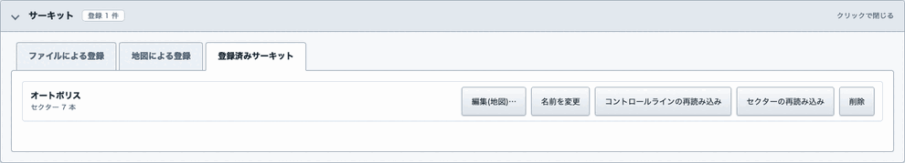

> **「使用するサーキット」を「自動判定」にした場合**は、登録済みのサーキットの中から、走行ログが計測ラインを通った場所で自動的に選ばれます(比較セットの中で最初に判定できたログのサーキット)。特定のサーキットを使いたいときは、ここで選びます。

### 位置補正(GPS のずれを直す)

GPS の記録は、ログによって数メートルずれていることがあります。ずれたまま比べると、ラインの差が正しく見えません。そのため、ログごとに位置を補正できます。

1. 「データ管理」タブで、補正したいファイルの **「位置補正」** を押します。
2. 右の欄の **「地図に出すラップ」** で、地図に表示するラップにチェックを付けます。最初は、A〜D のカードに割り当て中のラップ(無ければベストの 3 ラップ)にチェックが付いています。
3. 地図の左上で **「ラインを動かす」** を選び、走行ラインをドラッグして動かします。矢印キーで細かく動かせます(Shift で 10 倍)。最初は「地図を動かす」になっているので、地図の位置を合わせてから切り替えます。
4. **「適用して保存」** を押します。

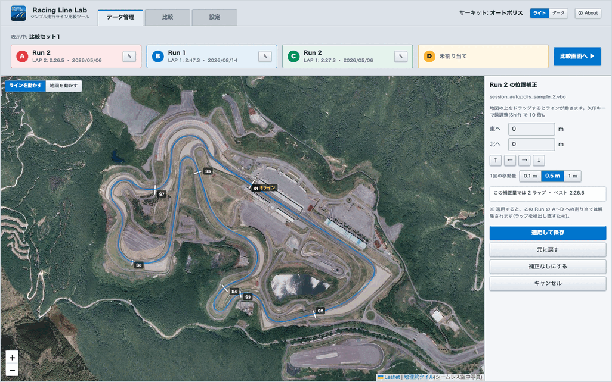

- 補正した値は、次回からも自動で使われます。
- 同じファイルを入れたすべての比較セットに、同じ補正が効きます。
- 補正しても、補正の前と同じラップが見つかれば、A〜D のカードの割り当てはそのまま残ります。補正でそのラップが無くなったとき(計測ラインを通らなくなったときなど)は、そのカードの割り当てだけが解除されます。補正している間も、右の欄でお知らせします。
- 「データ管理」タブの **「走行ライン補正データ管理」** で、補正データをファイル(JSON)に書き出したり、読み込んだりできます。別のパソコンなどに移すときに使います。

### 設定

「設定」タブで、アプリの起動時の状態を決めておけます。

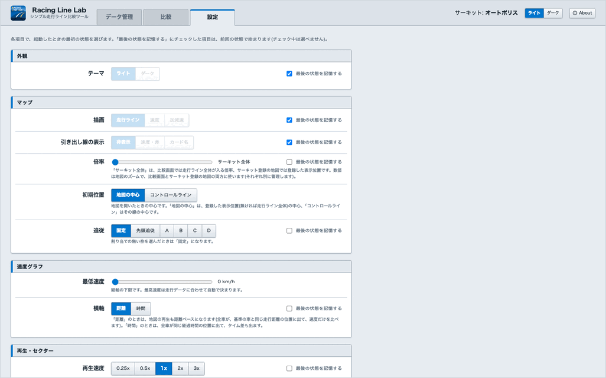

- **テーマ**: ライト / ダークの切り替え
- **地図**: ラインの表示(走行ライン/速度/加減速)、倍率、最初に開く位置。倍率は、比較画面とサーキット登録の地図の両方に使いますが、それぞれ別に管理します(登録画面で地図を拡大しても、比較画面の倍率は変わりません)
- **速度グラフ**: 速度レンジ(縦軸の最低速度と最高速度。最高速度は「自動」にもできます)、横軸
- **地図の保存**: ネットがない場所でも地図を表示するための保存範囲など(下の「ネットがない場所で使う」)
- **再生・セクター**: 再生速度、セクターボタンの動作
- **起動時**: 前回の走行データを自動で読み込むか
- **プライバシー**: 利用状況の送信(Web 版のみ。初期値はオン。デスクトップ版では「送信しない」のまま変えられません)

項目ごとに **「最後の状態を記憶する」** を選ぶと、その項目は前回使った状態で始まります。

「すべて初期値に戻す」は、この画面の設定項目だけを初期値に戻します。同じ行の右端にある **「アプリを初期状態に戻す」** は、テーマ・各種サイズ・登録したサーキット・位置補正・別名・前回のデータなど、保存されているすべてを消して、インストール直後の状態に戻します(誤操作を防ぐため、2 回押すと実行されます)。

### 前回のデータを自動で読み込む

デスクトップ版では、アプリを起動したときに、前回のすべての比較セットのファイルと割り当てが自動で元に戻ります(初期設定でオンです)。表示中の比較セットがあれば、そのまま「比較」タブが開きます。無ければ「データ管理」のまま、比較セットを閉じた状態で始まります。

- 元のファイルを移動・削除すると、そのファイルは読み込まれません。
- オフにするときは、「設定」タブの「最後の走行データを自動で読み込む」を切り替えます。

> Web 版では、前回のデータは保存されないため、この機能は使えません。

Web 版でも、**同じタブの中で画面が読み直されたとき**(スマホのスリープやアプリの切り替えのあと、手での再読み込みなど)は、読み込んだ走行ログ・割り当て・表示中の比較セットと、開いていた画面が元に戻ります。

- 新しいタブで開いたとき・タブを閉じて開き直したときは、初期状態で始まります。
- 比較画面の再生位置は戻りません。
- 走行ログが大きく一時保存できなかったときは、その旨が表示されます(そのときは、読み直されると元に戻りません)。

### ネットがない場所で使う

Web 版は、スマホなどにアプリとしてインストールできます。一度開いたあとは、ネットが無い場所(電波の届かないサーキットなど)でも起動できます。新しい版は、ネットがあるときに取得され、次に起動したときから使われます。デスクトップ版は、インストールしたアプリなので、起動にネットは要りません。

地図は、Web 版・デスクトップ版のどちらも、下の「地図を保存しておく」で保存した範囲が表示されます。

**アプリとしてインストールする**(Web 版。ネットのある所で)

- Android(Chrome): Web 版を開き、メニュー(︙)の「アプリをインストール」(または「ホーム画面に追加」)を選びます。
- iPhone・iPad(Safari): Web 版を開き、共有ボタンの「ホーム画面に追加」を選びます。
- ホーム画面には「R-LineLab」の名前で出ます。

**地図を保存しておく**(ネットのある所で)

地図(航空写真)は、「設定」タブの「地図の保存」で決めた **保存範囲** の中で表示したものが、端末に保存されます。ネットが無いときは、保存した地図が表示されます(保存していない部分は空白になりますが、走行ラインやグラフは使えます)。

1. 「設定」タブの「地図の保存」で、「＋ 範囲を追加」を押します。
2. 黄色の四角が保存範囲です。四隅の丸いつまみをつまんで(マウスでも指でも)、保存したい範囲に合わせます。真ん中のつまみで四角を動かせます。つまみを離すと、四角の辺は地図の写真の区切り線に吸い付きます。名前を付けて「この範囲を追加」を押します。
3. 比較画面などで、その範囲を見ておきます。表示した倍率の地図が保存されます(倍率 15〜18。それより拡大したときは、倍率 18 の地図を拡大して表示します)。

- 「概略の地図は表示前に保存する」を有効にすると、概略の地図(倍率 15・16。サーキット全体を見るときの粗い航空写真)は、範囲を追加・変更したときに、表示する前にまとめて保存されます。
- 範囲ごとに、保存した量が表示されます。「変更」「削除」で範囲を直したり消したりでき、範囲の外になった地図は消されます。「保存した地図をすべて消す」では、範囲は残して地図だけを消します。
- 「保存したデータを消されにくくする」(Web 版のみ)を有効にしておくと、端末の空きが少ないときに、ブラウザが保存したデータ(アプリと地図)を消さないよう頼みます。デスクトップ版はファイルに保存するので、この設定は要りません。
- 「アプリを初期状態に戻す」では、保存した地図と保存範囲も消えます。

> デスクトップ版では、保存した地図は、アプリの設定と同じ場所(Mac では `~/Library/Application Support/racing-line-lab/tiles`)に保存されます。

## 開発者の方へ

ソースコードからの実行、テスト、ファイル形式、プログラムの構成などは、[DEVELOPMENT.md](https://github.com/bpfj3ndcbr/racing-line-lab/blob/main/DEVELOPMENT.md) をご覧ください。

---

## 開発者

* 開発・公開: [bpfj3ndcbr](https://github.com/bpfj3ndcbr)(個人開発)
* リポジトリ: [https://github.com/bpfj3ndcbr/racing-line-lab](https://github.com/bpfj3ndcbr/racing-line-lab)
* © 2026 bpfj3ndcbr

不具合のご報告やご意見は、リポジトリの [Issues](https://github.com/bpfj3ndcbr/racing-line-lab/issues) へどうぞ(個人開発のため、対応できないこともあります)。

## 📜 ライセンス・利用規約と権利表記 (License & Credits)

### 1. 本アプリケーションのライセンス

本プロジェクトのソースコードは [MIT License](https://github.com/bpfj3ndcbr/racing-line-lab/blob/main/LICENSE) のもとで公開されています。商用・非商用を問わず自由にご利用・改変・再配布いただけます。

### 2. 地図タイルに関する権利表記

本アプリケーションでは、背景地図に国土地理院の提供する地理院タイルを使用しています。

* 地理院タイル(シームレス空中写真): [国土地理院](https://maps.gsi.go.jp/development/ichiran.html) 出典表記: 「地理院タイル(シームレス空中写真)」(利用規約に基づき、アプリケーション画面内の地図に明記されています)

### 3. 使用サードパーティライブラリ

* Leaflet: © Volodymyr Agafonkin, BSD-2-Clause License
* Electron: © Electron contributors, MIT License
* Vite: © Evan You & Vite Contributors, MIT License(ビルドに使用)

各ライブラリのライセンス詳細および著作権表記については、[THIRD-PARTY-NOTICES.txt](https://github.com/bpfj3ndcbr/racing-line-lab/blob/main/THIRD-PARTY-NOTICES.txt) をご参照ください。
